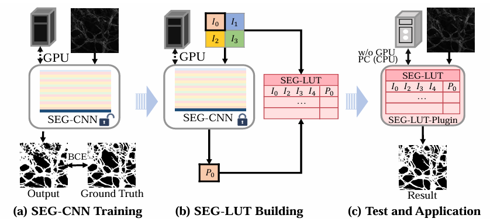
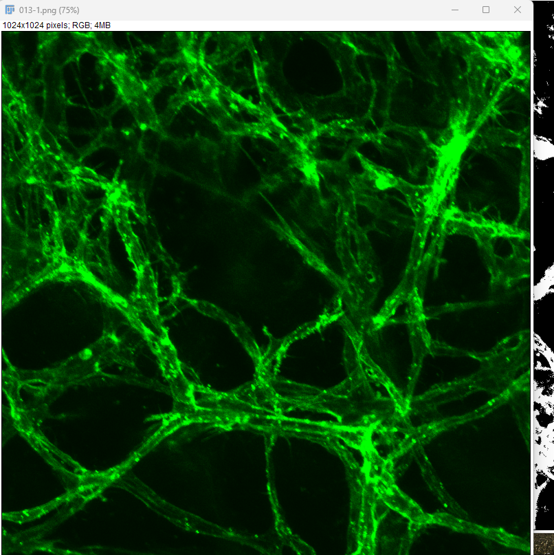
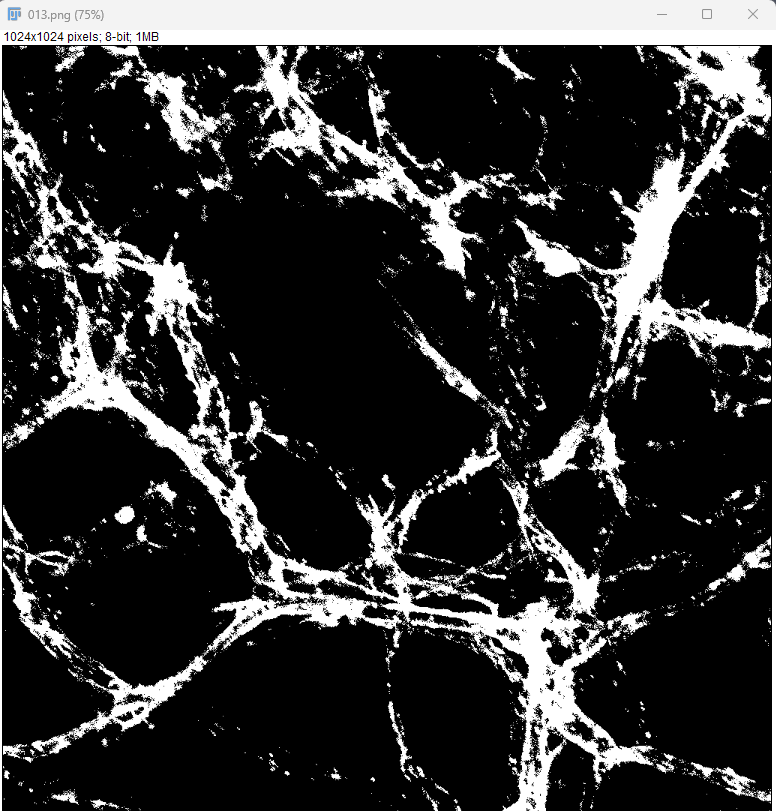
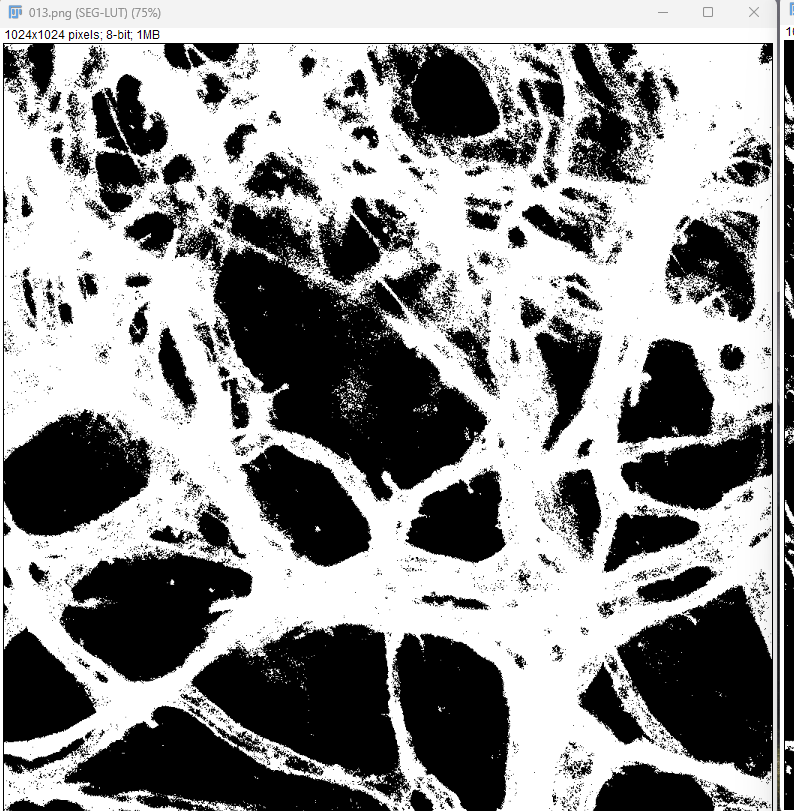

# Seg-LUT_HV

Lookup-table (LUT) accelerated image segmentation: train a small patch CNN, distill it into a 4D neighborhood LUT, and run fast inference in Python or Fiji/ImageJ.

## Workflow



| Panel | Step | What happens |
|:-----:|------|----------------|
| **(a)** | SEG-CNN training | A segmentation CNN is trained on the GPU (BCE loss vs. ground-truth masks). |
| **(b)** | SEG-LUT building | The trained CNN is frozen; all relevant 4-neighborhood inputs are forwarded once and stored in a **look-up table** (LUT). |
| **(c)** | Test & application | Inference uses **LUT lookup** on a CPU (no GPU)—including the **SEG-LUT** Fiji/ImageJ plugin in this repository. |

This repo implements stages **(a)–(c)** as folders `1_Train_deep_model` → `2_Transfer_to_LUT` → `3_Test_using_LUT` / `4_toImageJ`.

---

## Fiji / ImageJ plugin — install in 3 steps

**No Python required.** The LUT is already inside the JAR.

| Step | What to do |
|------|------------|
| **1** | Get **`Seg-LUT.jar`** from [`4_toImageJ/dist/Seg-LUT.jar`](4_toImageJ/dist/Seg-LUT.jar) (or build it; see below). |
| **2** | Copy the JAR into your Fiji **plugins** folder (create the folder if needed): |

**Windows**

```text
C:\Fiji.app\plugins\Seg-LUT.jar
```

**macOS**

```text
/Applications/Fiji.app/plugins/Seg-LUT.jar
```

**Linux**

```text
/path/to/Fiji.app/plugins/Seg-LUT.jar
```

| **3** | **Quit Fiji completely** and start it again. Open a grayscale (or RGB) image, then run **Plugins → Segmentation → SEG-LUT**. Accept the default probability threshold **0.50** unless you want to tune it. |

If **SEG-LUT** does not appear, open **Plugins → Segmentation** (it is a **submenu**, not a top-level Plugins item). Check **Help → Show Log** after restart for errors. You can also use **Plugins → Install Plugin…** and select `Seg-LUT.jar`, then restart.

### Example (same field of view in Fiji)

Confocal-style input and segmentation masks produced in ImageJ (Otsu: **Image → Adjust → Threshold**, method Otsu; SEG-LUT: **Plugins → Segmentation → SEG-LUT**, threshold 0.50).

| Original | Otsu (ImageJ) | SEG-LUT (ImageJ) |
|:--------:|:-------------:|:----------------:|
|  |  |  |

### Rebuild the JAR after a new LUT

Requires **JDK 8+** (`javac` on PATH, or let `package.ps1` auto-detect a JDK):

```powershell
cd 4_toImageJ\java
.\package.ps1
# Optional: point to a new .npy from Transfer_Model_Seg.py
.\package.ps1 -LutPath "..\..\2_Transfer_to_LUT\Seg2_LUT_HV_2_4.npy"
```

Output: `4_toImageJ/dist/Seg-LUT.jar` — copy this file to `Fiji.app/plugins/` again.

More detail: [`4_toImageJ/java/README.md`](4_toImageJ/java/README.md).

---

## Overview

The repository is organized as a four-stage pipeline:

| Stage | Directory | Purpose |
|-------|-----------|---------|
| 1 | [`1_Train_deep_model/`](1_Train_deep_model/) | Train the segmentation CNN |
| 2 | [`2_Transfer_to_LUT/`](2_Transfer_to_LUT/) | Enumerate 4D inputs and export a `.npy` LUT |
| 3 | [`3_Test_using_LUT/`](3_Test_using_LUT/) | Batch evaluation with LUT + simplex interpolation |
| 4 | [`4_toImageJ/`](4_toImageJ/) | Java Fiji plugin (`Seg-LUT.jar`) |

Bundled LUT for Python testing (also embedded in the JAR when you run `package.ps1`):

- **File:** `3_Test_using_LUT/Seg2_LUT_HV_2_4.npy`
- **`SAMPLING_INTERVAL`:** `4` (must match when exporting or loading the LUT)

Classical baselines: `otsu.py` and `triangle.py` in stage 1.

## Requirements

- Python 3.8+ (3.10 recommended) for training and LUT export
- PyTorch with CUDA optional
- [Fiji](https://fiji.sc/) for the plugin — **only the JAR**; no extra Python install for Fiji users

Install Python dependencies:

```bash
pip install -r requirements.txt
```

Training without Weights & Biases:

```bash
set WANDB_MODE=disabled   # Windows
export WANDB_MODE=disabled  # Linux/macOS
```

Optional W&B settings: `WANDB_PROJECT`, `WANDB_ENTITY`.

## Dataset layout

Images are **not** included in this repository. Place data as follows (each stage uses paths relative to its folder):

```
train/
  image/*.png
  mask/*.png
val/
  image/*.png
  mask/*.png
test/
  image/*.png
  mask/*.png
```

## Usage

### 1. Train

```bash
cd 1_Train_deep_model
python Train_Model_Seg.py
```

Checkpoints are written under `checkpoint/` (gitignored). Adjust `VERSION`, paths, and hyperparameters at the top of the script.

### 2. Export LUT

Place your trained weights (e.g. `model_G_i105000_best.pth`) and set `MODEL_PATH` in `2_Transfer_to_LUT/Transfer_Model_Seg.py`. Use the same `SAMPLING_INTERVAL` as the LUT you intend to ship (default **4**).

```bash
cd 2_Transfer_to_LUT
python Transfer_Model_Seg.py
```

Output: `Seg2_LUT_HV_2_<interval>.npy`.

### 3. Test with LUT

```bash
cd 3_Test_using_LUT
python test_lut.py
```

Settings: [`config.py`](3_Test_using_LUT/config.py). Predictions go to `output_Seg2_LUT_HV_2_test_<interval>bit/` (gitignored).

After exporting a new LUT, rebuild `Seg-LUT.jar` (see Fiji section above) so Fiji uses the updated model.

## Acknowledgments

The train → LUT → test pipeline in this repository adapts the look-up table workflow from [SR-LUT](https://github.com/yhjo09/SR-LUT) (Jo & Kim, CVPR 2021). We thank the authors for making their code publicly available.

## Citation

If you use this code, please cite our paper:

**Paper:** [A Deployable Microscopic Image Segmentation Look-Up Table Based on A Dilated CNN](https://link.springer.com/chapter/10.1007/978-3-031-77786-8_1) (MOVI 2024, LNCS vol. 15371)

```bibtex
@InProceedings{wu2025deployable,
  author    = {Wu, Yunheng and Pan, Jiazhen and Kawamura, Shuntaro and Oda, Masahiro and Hayashi, Yuichiro and Takebe, Takanori and Rueckert, Daniel and Mori, Kensaku},
  title     = {A Deployable Microscopic Image Segmentation Look-Up Table Based on A Dilated CNN},
  booktitle = {Medical Optical Imaging and Virtual Microscopy Image Analysis},
  series    = {Lecture Notes in Computer Science},
  volume    = {15371},
  pages     = {3--13},
  year      = {2025},
  publisher = {Springer},
  address   = {Cham},
  doi       = {10.1007/978-3-031-77786-8_1},
  url       = {https://link.springer.com/chapter/10.1007/978-3-031-77786-8_1}
}
```

## License

MIT — see [LICENSE](LICENSE).
